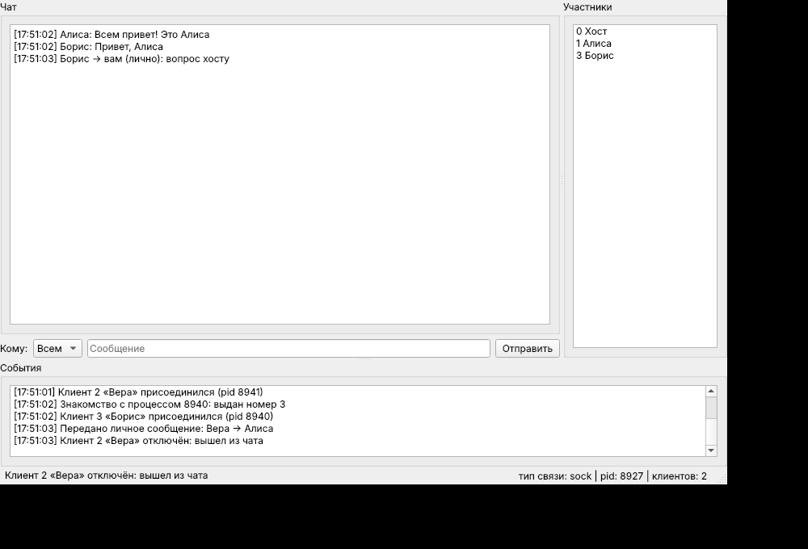

# Лабораторная работа №2. Локальный сетевой чат (вариант 20)

> **Вариант 20.** Сценарий 2 (локальный сетевой чат), конфигурация «Независимые. Один ко многим»,
> типы взаимодействия: программные каналы (`pipe`), именованные каналы (`fifo`), сокеты (`sock`).

Хост — участник чата с окном на Qt. Клиенты — консольные программы, которые запускаются
отдельно, в любом количестве, и получают pid хоста в командной строке. Хост сам пишет общие
и личные сообщения и пересылает сообщения клиентов: общие видят все, личные — только
отправитель и адресат. Клиент, который не пишет больше минуты, получает `SIGKILL`.
Сообщения показываются в порядке времени отправки.



## Как проверить за пять минут

```sh
make                                  # собрать host_pipe, host_fifo, host_sock, client_pipe, client_fifo, client_sock

./host_sock                           # 1. окно хоста; pid виден в заголовке и в строке состояния

./client_sock <pid хоста> Алиса       # 2. в другом терминале
./client_sock <pid хоста> Борис       # 3. в третьем

привет всем                           # 4. в окне Алисы: общее сообщение
@1 это только тебе                    # 5. в окне Бориса: личное сообщение Алисе (номер 1)
/to 0 вопрос хосту                    # 6. личное сообщение хосту
```

Хост и клиенты должны быть одного типа связи: `host_fifo` работает с `client_fifo` и т.д.

## Что требовалось и где это сделано

| Требование | Реализация |
|---|---|
| хост запускается первым и создаёт всё для связи | `src/host.cpp`, `src/host/Server.cpp` |
| независимые клиенты получают pid хоста | `./client_<тип> <pid хоста> [имя]`, `src/client.cpp` |
| двустороннее знакомство сигналом | клиент шлёт `SIGUSR1` хосту, хост создаёт канал и семафоры и отвечает `sigqueue(SIGUSR1)`, в значении сигнала — номер клиента в сессии (`src/link/Signals.cpp`) |
| по номеру клиент находит свои дескрипторы | имена каналов, сокетов и семафоров строятся из pid хоста и номера (`src/link/Names.cpp`) |
| синхронизация глобальными семафорами | по два `sem_open`-семафора на клиента: `…-up` (клиент → хост) и `…-down` (хост → клиент), `src/link/GlobalSemaphore.cpp` |
| тайм-ауты 5 с, после них связь рвётся, клиент завершается | каждое ожидание семафора, сигнала знакомства и подключения — не дольше 5 с (`src/link/Timeouts.hpp`) |
| отдельный поток на каждого клиента | `Server::serve` в своём `std::thread`; ещё есть поток приёма сигналов и поток «часов» |
| GUI-часть на Qt | окно хоста `src/gui/ChatWindow.cpp`: чат, участники, выбор адресата, поле ввода, журнал событий |
| статусные сообщения в окне | «Хост запущен», «Знакомство с процессом…», «присоединился», «отключён: причина», «Передано личное сообщение…» |
| вывод ошибок в лог | `syslog` (`lab2_host`, `lab2_client`), хост дублирует записи в stderr |
| каждый тип взаимодействия — свой файл `conn_*` с классом `Conn` | `src/conn/conn_pipe.cpp`, `conn_fifo.cpp`, `conn_sock.cpp`, общий интерфейс `src/conn/conn.hpp` |
| `host_*` и `client_*` для каждого `conn_*`, всё через `make` | `CMakeLists.txt` находит `conn_*.cpp` сам; `Makefile` вызывает `build.sh` |
| каждый `*.cpp` компилируется без правки CMakeLists | `file(GLOB_RECURSE … CONFIGURE_DEPENDS src/*.cpp)` |
| флаги `-Wall -Werror` | `add_compile_options(-Wall -Werror)` |
| `build.sh` убирает промежуточные файлы cmake | cmake работает во временном каталоге, он удаляется всегда |
| после работы хост удаляет файлы именованных каналов | деструктор `Conn` в `conn_fifo.cpp` и удаление рабочего каталога |
| молчащий больше минуты клиент получает `SIGKILL` | `Server::evictSilent`, остальные участники видят причину |
| порядок по времени отправки | `src/chat/Hub.cpp`, см. ниже |
| тесты | `tests/`: модульные на C++ и сценарии на bash с настоящими программами |

## Как это работает

```
клиент                                        хост
  |  SIGUSR1 ---------------------------------> |  поток сигналов: создать семафоры и канал
  |  <------------------- sigqueue(SIGUSR1, N)  |  ответить номером N, запустить поток клиента
  |  открыть семафоры и канал N                 |
  |  Hello(имя) -> sem_post(up)                 |  поток клиента: sem_timedwait(up) -> прочитать
  |  sem_timedwait(down) <- Welcome(N, список)  |  ответить -> sem_post(down)
  |  каждые 200 мс: Poll(новые сообщения) ----> |  принять сообщения
  |  <------ Update(сообщения, события, список) |  отдать то, что накопилось для клиента
  |  Bye --------------------------------------> |  Closed("вы вышли из чата")
```

- **Кадры.** Отправитель пишет кадр целиком (`подпись, длина, данные`) и только потом делает
  `sem_post`; получатель ждёт семафор с тайм-аутом (`sem_clockwait` по `CLOCK_MONOTONIC`,
  поэтому перевод системных часов не влияет на тайм-аут) и читает кадр. Кадр не больше 56 КиБ,
  то есть всегда помещается в буфер канала, и запись не блокируется.
- **Обмен.** Клиент раз в 200 мс отправляет запрос со своими новыми сообщениями и получает
  в ответ всё, что накопилось для него. Пустые запросы заодно служат проверкой связи:
  если хост не ответил за 5 с, клиент пишет «Связь с хостом потеряна: тайм-аут ожидания»
  и завершается с кодом 1. Если 5 с молчит клиент, хост отключает его и сообщает остальным.
- **Порядок.** Клиент ставит на сообщение время, когда строка была введена. Хост держит
  каждое сообщение 450 мс (дольше, чем период опроса клиентов), затем выпускает накопившиеся
  сообщения, отсортированные по времени отправки, и раздаёт адресатам. Сообщение, которое
  всё равно опоздало, никогда не встанет раньше уже выпущенных: его время подтягивается до
  последнего выпущенного. Поэтому у всех участников и у хоста лента одна и та же.
- **Личные сообщения** попадают только к отправителю и адресату. Если ни тот, ни другой
  не хост, в окне хоста появляется лишь событие «Передано личное сообщение: А -> Б» без текста.
- **Молчание.** Хост помнит для каждого клиента время последнего отправленного сообщения
  (или подключения). Поток «часов» раз в 100 мс проверяет, кто молчит дольше 60 с, и
  отправляет ему `SIGKILL`. Для проверки без минутного ожидания предел задаётся переменной:
  `LAB2_SILENCE_SEC=10 ./host_sock`.
- **Текст.** Хост убирает из имён и сообщений управляющие символы, escape-последовательности
  терминала и испорченный UTF-8, ограничивает длину (сообщение — 1000 байт, имя — 24 байта)
  и делает имена уникальными.
- **Завершение.** Хост закрывается кнопкой окна, `Ctrl+C` в его терминале или `kill -TERM`:
  клиенты получают «Чат закрыт: хост завершает работу». Если хост убит `SIGKILL`, клиенты
  замечают это сами, а следующий запущенный хост удаляет оставшиеся каталоги и семафоры.

### Типы связи

| Тип | Канал между хостом и клиентом N |
|---|---|
| `pipe` | хост создаёт два `pipe2()` и закрепляет концы клиента на дескрипторах `600 + 2N` (чтение) и `601 + 2N` (запись). Клиент — независимый процесс, поэтому открывает их через `/proc/<pid хоста>/fd/…`; как только клиент прислал первые данные, хост закрывает свои копии, и обрыв канала виден обеим сторонам |
| `fifo` | `mkfifo` `/tmp/lab2chat-<pid хоста>/cN.up.fifo` и `cN.down.fifo`; хост удаляет файлы при отключении клиента и при завершении |
| `sock` | Unix-сокет `/tmp/lab2chat-<pid хоста>/cN.sock`: хост слушает, клиент подключается |

Семафоры: `/lab2chat-<pid хоста>-cN-up` и `/lab2chat-<pid хоста>-cN-down` (в Linux видны как
`/dev/shm/sem.lab2chat-…`).

## Что лежит в папке

```
lab2/
├── Makefile                      make, make test, make clean
├── build.sh                      сборка через cmake во временном каталоге
├── CMakeLists.txt                host_<тип> и client_<тип> для каждого src/conn/conn_<тип>.cpp
├── docs/host_window.png          снимок окна хоста
├── src/
│   ├── host.cpp                  main хоста
│   ├── client.cpp                main клиента
│   ├── conn/                     conn.hpp (класс Conn), conn_pipe.cpp, conn_fifo.cpp, conn_sock.cpp
│   ├── link/                     глобальные семафоры, кадры поверх Conn (Link), знакомство сигналами,
│   │                             имена, рабочий каталог /tmp/lab2chat-<pid>, дескрипторы
│   ├── chat/                     сообщения, упаковка запросов и ответов, состояние чата (Hub),
│   │                             очистка текста, вид строк чата
│   ├── host/                     сервер хоста: знакомство, поток на клиента, пересылка, SIGKILL
│   ├── client/                   сессия клиента, разбор команд, чтение строк, вывод в консоль
│   ├── gui/                      окно хоста (Qt Widgets)
│   └── util/                     syslog, время, ошибки
└── tests/
    ├── run_all.sh                все тесты одной командой
    ├── unit/                     модульные тесты (свой каркас check.hpp)
    ├── link/                     тесты Conn и сервера, собираются отдельно для каждого типа связи
    └── integration/              сценарии с настоящими host_* и client_*: 01_build.sh … 07_cleanup.sh
```

## Установка и сборка

Нужны CMake 3.16+, make, компилятор C++17 (GCC 9+ или Clang) и Qt 6 или Qt 5 с модулем Widgets.

| Дистрибутив | Пакеты |
|---|---|
| Ubuntu, Debian | `sudo apt install cmake make g++ qt6-base-dev` |
| Fedora | `sudo dnf install cmake make gcc-c++ qt6-qtbase-devel` |
| Arch | `sudo pacman -S cmake make gcc qt6-base` |

Где нет Qt 6, подойдёт Qt 5 (`qtbase5-dev` в Debian/Ubuntu): CMake выберет найденную версию.

```sh
make            # = sh build.sh: собрать все host_* и client_* в этой папке
make clean      # удалить собранные программы
```

`build.sh` настраивает и собирает проект во временном каталоге `mktemp -d`, копирует
готовые программы в папку проекта и удаляет временный каталог — и после удачной сборки,
и после ошибки, и при `Ctrl+C`. Новый файл `src/conn/conn_<тип>.cpp` сам даёт программы
`host_<тип>` и `client_<тип>`, новый `src/**/*.cpp` сам попадает в сборку — правка
`CMakeLists.txt` не нужна.

## Запуск

```sh
./host_fifo                           # хост
./client_fifo <pid хоста> [имя]       # клиент; без имени будет «Участник N»
```

В окне хоста сообщение пишется в нижней строке, адресат выбирается слева: «Всем» или
конкретный участник. Команды клиента:

| Команда | Что делает |
|---|---|
| `текст` | сообщение всем |
| `/to N текст` или `@N текст` | личное сообщение участнику N, у хоста номер 0 |
| `/who` | список участников |
| `/help` | список команд |
| `/quit`, `Ctrl+D`, `Ctrl+C` | выйти из чата |

Коды выхода клиента: 0 — вышел сам или хост закрыл чат; 1 — не удалось подключиться или
связь потеряна; 2 — неверные аргументы. Клиента, убитого хостом за молчание, оболочка
покажет как `Killed` (код 137).

Окно хоста без графического экрана: по ssh с X11 (`ssh -X`, MobaXterm), в WSL на Windows 11
окно открывается само; совсем без окна — `QT_QPA_PLATFORM=offscreen ./host_sock`, тогда все
события видны в stderr и в журнале.

## Журналы

| Что | Где |
|---|---|
| хост | stderr хоста, `journalctl -t lab2_host -f` или `grep lab2_host /var/log/syslog` |
| клиенты | `journalctl -t lab2_client` или `grep lab2_client /var/log/syslog` |

## Тесты

```sh
make test                             # = bash tests/run_all.sh: всё (около 3 минут)
bash tests/run_all.sh unit            # только модульные
bash tests/run_all.sh chat silence    # выбранные сценарии по части имени
```

Скрипт собирает проект вместе с тестами во временном каталоге и запускает:

- **модульные тесты** (`tests/unit`, 53 теста): упаковка пакетов и защита от испорченных
  данных, очистка текста, состояние чата (доставка общих и личных сообщений, порядок по
  времени отправки, опоздавшие сообщения, молчащие клиенты, уникальные имена), разбор
  команд, чтение строк, глобальные семафоры и тайм-ауты, знакомство сигналами, рабочий
  каталог и уборка за упавшим хостом, окно хоста (в режиме `offscreen`);
- **тесты связи и сервера** (`tests/link`, по 10 на каждый тип связи): обмен кадрами между
  процессами, большие и пустые кадры, тайм-аут, обрыв, удаление семафоров, полный цикл
  клиент — сервер хоста, отключение клиента без приветствия;
- **сценарии** (`tests/integration`) с настоящими программами для всех трёх типов:
  1. `01_build` — `make`, нет следов cmake, `make clean`, новый `conn_*.cpp` даёт новые
     программы, предупреждение компилятора ломает сборку;
  2. `02_chat` — общие и личные сообщения, сообщения хосту, ошибки адресата, команды,
     выход клиента, конец ввода, закрытие хоста;
  3. `03_order` — три клиента вперемешку отправляют 15 сообщений, у всех одинаковый порядок,
     совпадающий с порядком отправки;
  4. `04_silence` — молчащий клиент получает `SIGKILL`, пишущий остаётся;
  5. `05_timeouts` — зависший хост, зависший клиент, убитый хост: связь рвётся через 5 с;
  6. `06_handshake` — неверные аргументы, несуществующий pid, процесс без ответа на `SIGUSR1`,
     8 клиентов подключаются одновременно;
  7. `07_cleanup` — каналы и семафоры удаляются при выходе клиента и хоста, остатки после
     `SIGKILL` хоста убирает следующий запуск.
